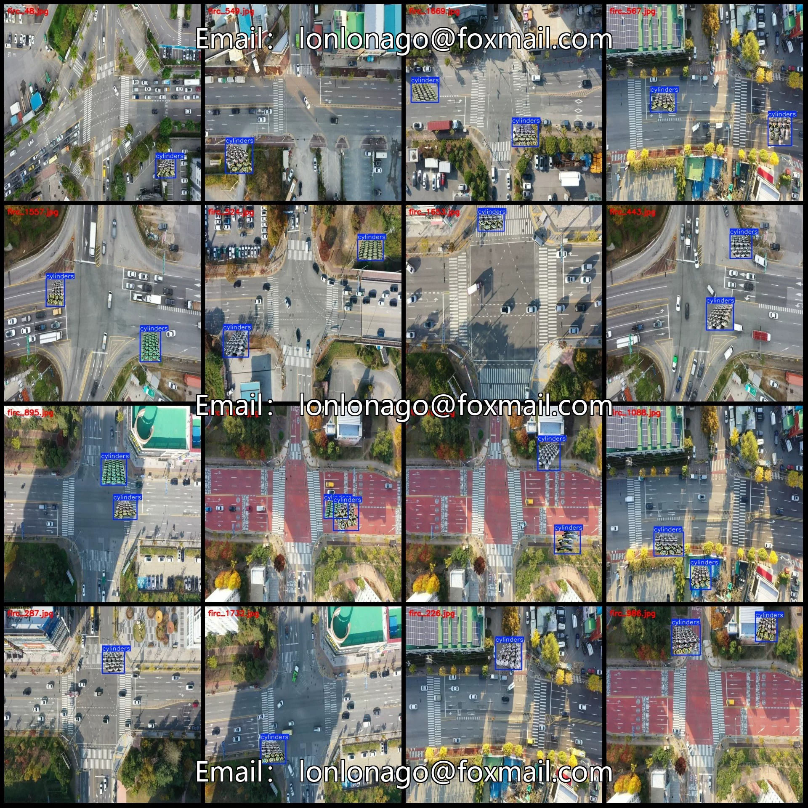
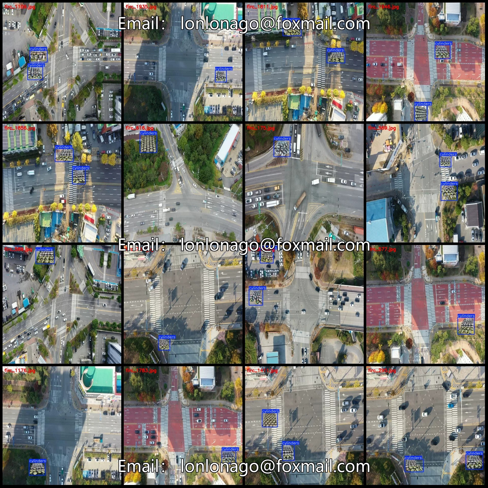
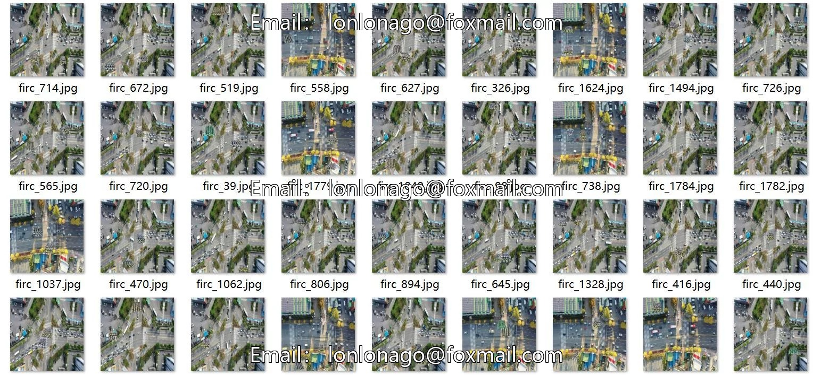
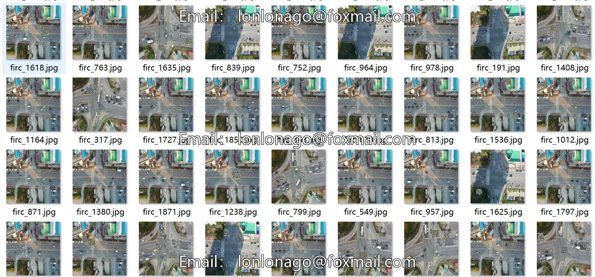

# Drone-view outdoor illegal stacking of gas cylinders and flammable explosives detection dataset VOC+Y

## Body

Drone Viewpoint Open-Air Illegal Stacking of Gas Tanks and Explosive and Flammable Items Detection Data Set in VOC+YOLO format, 1958 images in a single category
Warm Reminder: Due to the dataset's replicability, please confirm compliance with requirements before purchasing.
Please note that this dataset is a compilation of images where randomly placed gas tanks are superimposed onto background pictures, as detailed in the images.
The introduction has already thoroughly explained the details of the dataset. Please do not request refunds based on reasons such as the composite being too fake, the images are composited, not real scenes, or the images are blurry and unclear. Before purchasing, please contact the seller for a detailed understanding of the dataset. Once sold, it represents your agreement to the dataset and acknowledgement of the introduction.

Dataset format: Pascal VOC format + YOLO format (txt file without split path, only containing jpg images and corresponding VOC format xml files and yolo format txt files)
Number of images (number of jpg files): 1958
Number of annotations (number of xml files): 1958
Number of annotations (number of txt files): 1958
Number of annotation categories: 1
Annotation category names: ["cylinders"]
Number of boxes per category
cylinders box count = 2928
Total box count: 2928
Number of images per category
cylinders image count = 1958
Image resolution: 640x640

Use labeling tool: labelImg
Labeling rules: Draw a rectangle around the category.
Important note: The dataset does not have separate training, validation, and test sets; you need to partition them yourself.

## Images

## Payment

Here is a pay link on Stripe ( https://buy.stripe.com/3cs8yP7sY87d0vu9AB ). Please contact me lonlonago@foxmail.com after funding $89, and I will send you a complete data files , thank you!

